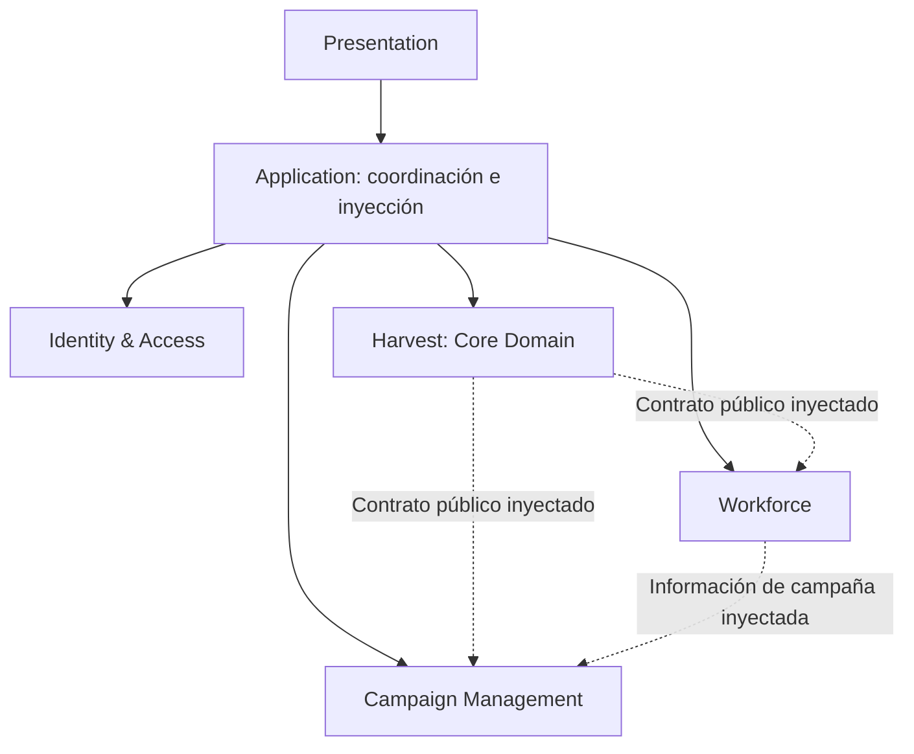

# GesGROW: límites de contexto y organización DDD

GesGROW sigue siendo un monolito modular. Harvest es el Core Domain actual. F5.1 introduce el nuevo modelo de tickets, F5.2 conecta generación/consulta con SQL, F5.3 confirma asignación por lote y F5.4 confirma cosecha con consumo único. F5.5 conecta el PDA con caché, reservas offline y reconciliación en IndexedDB v5. No introduce eventos, mensajería, microservicios o React.

[F5.6](harvest-tickets-f5.6.md) añade un cutover explícito por campaña, congela escrituras legacy y unifica las proyecciones de producción. La implementación está validada localmente; las migraciones no se han desplegado remotamente y quedan pendientes las pruebas de PostgreSQL real y PDA en staging.

[Platform F6.3](platform-suscripciones-f6.3.md) añade planes, suscripciones y entitlements independientes de los permisos Identity. La composición verifica permiso y módulo antes de las operaciones, y el servidor revalida ambos.

[Platform F6.4](platform-ciclo-vida-f6.4.md) administra el ciclo comercial con permisos delegados, cambios programados, operaciones idempotentes y auditoría inmutable, manteniendo la resolución de capacidades fuera de los BC operativos.

[Portal F7.1](portal-web-f7.1.md) introduce un container React/Vite en `portal`, independiente de la PWA. Presentation y Application consumen Identity/TenantContext y Platform por APIs públicas y puertos, sin importar infraestructura ni modificar la aplicación de campo.

## Contextos estratégicos

| Contexto            | Estado                   | Responsabilidad actual                                                                  |
| ------------------- | ------------------------ | --------------------------------------------------------------------------------------- |
| Identity & Access   | Implementado F6.2        | Usuario independiente, membresías, permisos efectivos y TenantContext; DNI provisional. |
| Workforce           | Implementado             | Trabajadores, cosechadores, jaberos, roles laborales y búsqueda provisional.            |
| Campaign Management | Implementado             | Campaña, información de cultivo, variedades y selección/contexto de campaña.            |
| Harvest             | Core Domain implementado | Asignaciones, sesiones, lecturas, producción y reportes de cosecha.                     |
| Platform Management | Implementado F6.1        | EmpresaCliente/Tenant, ownership organizacional y puerto TenantContext.                 |
| Farm Structure      | Implementado F8          | Fundo, Sector y ParcelaAgricola; estructura física persistente por Tenant.              |

## APIs públicas y colaboraciones

Cada contexto publica explícitamente su API mediante index.js. Los consumidores externos no importan application/, domain/ o ports/ de otro contexto. Los factories y funciones conservan sus nombres y resultados actuales. La composición pwa/src/application/crearCasosDeUso.js importa esas APIs y recibe las implementaciones desde bootstrap.

| Colaboración lógica                                          | Contrato inyectado                                                                                         |
| ------------------------------------------------------------ | ---------------------------------------------------------------------------------------------------------- |
| Harvest necesita Workforce                                   | Obtener un trabajador y validar su aptitud actual de jabero para inicio/lectura.                           |
| Harvest necesita Campaign Management                         | Seleccionar una variedad sobre la proyección operativa de lote existente.                                  |
| Campaign Management necesita Farm Structure                  | Referencias públicas de parcelas; vínculo opcional M:N con lotes operativos.                                |
| Workforce necesita Campaign Management                       | Obtener la información de la campaña activa local para buscar al cosechador.                               |
| Campaign Management recibe el resultado de Identity & Access | Application pasa el operador autorizado y sus campañas asignadas al ingreso; se conserva el DTO existente. |

Application conecta los contratos públicos anteriores y conserva la continuación de sincronización posterior a la UI. Campaign Management consume la API pública de Platform para contrastar ownership, sin importar internos. Dentro de shared/src/shared/ permanece únicamente la clasificación técnica de errores de conexión.

Los puertos de backend de cada contexto cubren los métodos existentes de Backend Facade. Los adapters concretos permanecen en infrastructure/supabase, infrastructure/indexeddb e infrastructure/offline. Los puertos técnicos de cola y sincronización y la validación de la composición permanecen en pwa/src/ports/offline. El contrato compuesto cosecha de Fase 3 conserva compatibilidad y se proyecta en los puertos de Harvest y Workforce.

## Fuera de los contextos por decisión explícita

- main.js: composición de presentación e inyección de consultas, casos de uso y puertos técnicos. Los módulos conservan el estado de sus flujos. bootstrap.js configura adaptadores y acceso del dispositivo antes de cargar main.js; la restauración del operador comienza después de montar los colaboradores.
- presentation/ingreso/: index.js conserva el operador y coordina login, restauración, autorización diaria, escáner protegido y salida; campanias.js presenta la selección de campaña mediante la API pública de Campaign Management. Recibe almacenamiento de sesión y operaciones técnicas por inyección; invalida respuestas tardías al cancelar o iniciar otro ingreso.
- presentation/arranque/: navegacion.js coordina las pantallas y el menú general; teclados.js configura los seis campos manuales; eventos.js registra conexión, foco, visibilidad, captura de clics y sincronización periódica de 30 segundos. Recibe colaboradores y temporizadores por inyección. El acceso del dispositivo conserva su composición en bootstrap.js.
- presentation/reportes/: vistas de resumen, ranking y producción diaria/por lote; cada una conserva su estado y sus eventos. Reciben consultas, navegación y lectura de lotes por inyección, sin importar infraestructura ni almacenamiento concreto.
- application/crearConsultasReportes.js: coordina las consultas de Harvest con el puerto backend recibido, incorporando DNI, campaña y opciones de período/zona horaria. Rechaza respuestas de una campaña que ya no esté seleccionada.
- presentation/consultas/: cuatro vistas con estado privado para asignaciones, jaberos, cosechadores y sesiones; configuración y navegación contextual; controlador compartido de búsqueda y actualización. Invalida cargas pendientes al cambiar de vista y conserva el diálogo nativo y sus garantías de foco.
- application/crearConsultasOperativas.js: coordina lecturas locales y enriquecimiento mediante APIs públicas de Harvest/Workforce. Recibe los lectores y la actualización de caché por inyección; no importa DOM, IndexedDB ni infraestructura. Comprueba el operador y campaña antes de aceptar los resultados.
- presentation/operacion/asignacionTickets.js y registroJaberos.js: formularios con estado privado, mensajes, foco, teclado y temporizador. Invocan los casos de uso existentes por inyección, reciben la configuración de escáner protegida por autorización y mantienen la liberación tras el guardado local. No conocen comandos de la cola ni generan UUID.
- presentation/lectura/: index.js mantiene la sesión activa y coordina los casos de uso de inicio/lectura/cierre; configuracion.js maneja lote/variedad; sesionesRestaurables.js presenta tarjetas locales y sus acciones. Recibe consultas técnicas por inyección, normaliza id/sesion_id al continuar y descarta presentación o confirmaciones de un estado anterior. Los guardados ya iniciados mantienen su sincronización al limpiar la interfaz.
- presentation/sincronizacion/: index.js presenta la lista por campaña y coordina acciones; tarjetaOperacion.js muestra errores y acciones disponibles; estadoConexion.js presenta conectividad y conteos. Recibe operaciones de cola, política de descarte y sincronización por inyección; no implementa la persistencia ni cambia la política offline. Invalida cargas/acciones de una vista anterior y comprueba autorización antes de operar.
- modules/scanner.js, tecladoManual.js, confirmacion.js, diagnosticoScanner.js y vistaSesionLectura.js: UI y dispositivo.
- modules/cacheOperativa.js: coordinación de una caché que mezcla autorización, campaña, trabajadores y cosecha; no se declara entidad de un único contexto.
- modules/asignacionTickets.js y cosechadorLocal.js: aliases de compatibilidad sin reglas de negocio; delegan a Application o a una API pública. Se retiró el wrapper sin consumidores modules/auth.js; el ingreso llama a Application directamente.
- offline/db.js, harvest.js, campanias.js, cola.js y sync.js: implementaciones de persistencia, reservas, particionado, comandos y sincronización, envueltas por infrastructure. Application accede únicamente a sus puertos.
- Backend Facade y errores de backend: contratos técnicos independientes del proveedor.

## Ambigüedades preservadas

1. [F8](farm-structure-f8.md) distingue ParcelaAgricola física de LoteOperativoCampania. Las tablas/contratos legacy de lote siguen siendo operativos; los vínculos M:N son opcionales y no atribuyen producción histórica a parcelas. La correspondencia real requiere validación de negocio.
2. La caché operativa contiene datos de varios contextos. La pertenencia del envoltorio no implica propiedad sobre Trabajador ni sobre Campaña.
3. Un operador autorizado y un trabajador pueden compartir DNI, pero identidad/autorización y rol laboral son conceptos distintos; no se unifican en las utilidades técnicas de shared/src/shared/.
4. Asignar un ticket también mantiene el rol local provisional COSECHADOR en la transacción existente. La propiedad conceptual es Workforce, pero no se divide esa escritura con el cambio de Harvest.
5. El nombre ResumenCampania describe alcance temporal, no propietario: al medir producción pertenece a Harvest.
6. El histórico de lectura conserva tickets repetidos. F5.3 confirma lotes completos con ASIGNAR_TICKET y F5.4 confirma consumo único con REGISTRAR_JABA. [F5.5](harvest-tickets-f5.5.md) incorpora reserva y consumo offline; F5.6 combina fuentes mediante una frontera explícita de admisión, sin convertir histórico.

## Garantías de compatibilidad

IndexedDB scc migra de v4 a v5 añadiendo cinco stores Harvest y conservando todos los stores/filas anteriores. F5.6 mantiene v5 y amplía la política en meta. Los payloads, UUID y comandos actuales se mantienen. Las nuevas escrituras confirman reserva, comando y registro provisional en una transacción; snapshot confirmado y reservas permanecen separados. Los rechazos invalidan producción provisional y bloquean dependientes, conservando su auditoría. Las intenciones v4 preservan su modelo/recibo; sus repeticiones legacy admitidas permanecen históricas, y las no admitidas después del corte se rechazan. Los aliases RPC siguen disponibles, los reportes comparten una proyección de ambas fuentes y las tablas/datos legacy se conservan como solo lectura para campañas migradas. No se modifican archivos de Google Sheets ni Apps Script.

Harvest publica el puerto `HarvestLocal` para reservas de asignación/consumo y valida el contrato del snapshot reconstruyendo sus agregados. La composición productiva usa `infrastructure/indexeddb/harvestAdapter.js`. Las reglas de autorización/campaña/aptitud siguen perteneciendo a Identity, Campaign Management y Workforce; el snapshot incorpora la proyección pública UUID↔DNI de Workforce sin crear roles.

Las pruebas arquitectónicas bloquean imports a internos de otro contexto, acceso de contextos a infraestructura/IndexedDB/UI/SDK, dependencias de domain hacia application o ports y roles laborales definidos dentro de Harvest.

## Inventario físico

### platform

F6.1 introduce `domain/empresaCliente.js`, `application/crearEmpresaCliente.js`,
`application/resolverTenantContext.js`, `ports/empresasCliente.js`,
`ports/tenantContext.js` e `index.js`. Campaign Management incorpora Campaña y
Workforce incorpora Trabajador con Tenant explícito.
Véase [F6.1 — EmpresaCliente / Tenant](platform-tenants-f6.1.md) para la migración,
restricciones, compatibilidad local y límites de la autenticación provisional.

### identity-access

- shared/src/contexts/identity-access/application/authLogic.js
- shared/src/contexts/identity-access/application/validarOperador.js
- shared/src/contexts/identity-access/domain/fechaOperativa.js
- shared/src/contexts/identity-access/index.js
- shared/src/contexts/identity-access/ports/backend.js
- shared/src/contexts/identity-access/ports/operadores.js

### workforce

- shared/src/contexts/workforce/application/buscarCosechadorLocal.js
- shared/src/contexts/workforce/application/queries/jaberosCampania.js
- shared/src/contexts/workforce/application/registrarJabero.js
- shared/src/contexts/workforce/application/registroJaberos.js
- shared/src/contexts/workforce/domain/cosechadorLocal.js
- shared/src/contexts/workforce/domain/jaberos.js
- shared/src/contexts/workforce/index.js
- shared/src/contexts/workforce/ports/backend.js
- shared/src/contexts/workforce/ports/campaignManagement.js
- shared/src/contexts/workforce/ports/trabajadores.js

### campaign-management

- shared/src/contexts/campaign-management/application/ingresarCampania.js
- shared/src/contexts/campaign-management/domain/campaniaOperador.js
- shared/src/contexts/campaign-management/domain/variedadesLote.js
- shared/src/contexts/campaign-management/index.js
- shared/src/contexts/campaign-management/ports/backend.js
- shared/src/contexts/campaign-management/ports/campanias.js

### harvest

- shared/src/contexts/harvest/application/asignacionTickets.js
- shared/src/contexts/harvest/application/asignarTicket.js
- shared/src/contexts/harvest/application/asignarLoteDeTickets.js
- shared/src/contexts/harvest/application/registrarCosecha.js
- shared/src/contexts/harvest/application/solicitudesHarvestOffline.js
- shared/src/contexts/harvest/application/operarSegunCutover.js
- shared/src/contexts/harvest/application/generarLotesDeTickets.js
- shared/src/contexts/harvest/application/resolverCatalogoDeTickets.js
- shared/src/contexts/harvest/application/cerrarSesionLectura.js
- shared/src/contexts/harvest/application/iniciarSesionLectura.js
- shared/src/contexts/harvest/application/lecturaJabas.js
- shared/src/contexts/harvest/application/queries/asignadosHoy.js
- shared/src/contexts/harvest/application/queries/cosechadoresJabas.js
- shared/src/contexts/harvest/application/queries/sesionesLectura.js
- shared/src/contexts/harvest/application/registrarLecturaJaba.js
- shared/src/contexts/harvest/application/reports/produccionDiaria.js
- shared/src/contexts/harvest/application/reports/produccionLotes.js
- shared/src/contexts/harvest/application/reports/rankingCosechadores.js
- shared/src/contexts/harvest/application/reports/resumenCampania.js
- shared/src/contexts/harvest/domain/validacionesLectura.js
- shared/src/contexts/harvest/domain/loteDeTickets.js
- shared/src/contexts/harvest/domain/ticket.js
- shared/src/contexts/harvest/domain/asignacionDeLote.js
- shared/src/contexts/harvest/domain/registroCosecha.js
- shared/src/contexts/harvest/domain/snapshotTickets.js
- shared/src/contexts/harvest/domain/cutoverHarvest.js
- shared/src/contexts/harvest/domain/catalogoDeTickets.js
- shared/src/contexts/harvest/domain/erroresTickets.js
- shared/src/contexts/harvest/domain/identificadoresTickets.js
- shared/src/contexts/harvest/index.js
- shared/src/contexts/harvest/ports/backend.js
- shared/src/contexts/harvest/ports/campaignManagement.js
- shared/src/contexts/harvest/ports/cosecha.js
- shared/src/contexts/harvest/ports/tickets.js
- shared/src/contexts/harvest/ports/harvestLocal.js
- shared/src/contexts/harvest/ports/workforce.js
